<div align="center">



<br>

[](https://github.com/NTIC-Solution/syngard/actions/workflows/check.yml)
[](https://github.com/NTIC-Solution/syngard/actions/workflows/security.yml)
[](https://github.com/NTIC-Solution/syngard/actions/workflows/commits.yml)
[](https://ntic-solution.github.io/syngard/)
[](https://scorecard.dev/viewer/?uri=github.com/NTIC-Solution/syngard)

[](#license)
[](rust-toolchain.toml)
[](https://ntic-solution.github.io/syngard/concepts/security-model/)
[](https://github.com/NTIC-Solution/syngard/milestones)

**Local-first integrity control for AI agent instructions: `AGENTS.md`, `CLAUDE.md`, `SKILL.md` and the scripts they reference.**

[Documentation](https://ntic-solution.github.io/syngard/) · [Documentation en français](https://ntic-solution.github.io/syngard/fr/) · [Quick start](#quick-start) · [Security](SECURITY.md) · [Contributing](CONTRIBUTING.md)

</div>

---

## Why

Coding agents obey plain text files. A new `AGENTS.md` in a parent directory, a
script edited next to a skill that was already reviewed, an instruction dropped
into a downloads folder: the agent's behavior changes and nobody approved it.

Syngard answers one question: **are the bytes my agents will read exactly the
ones that were recorded for this bundle?**

- **Analysis** explains risk in content.
- **Integrity** establishes whether content is byte-identical to a reference.
- **Approval and enforcement** decide whether a session may use it.

These stay separate. Syngard never shows a single "safe" badge.

> The name comes from **Syn**, the Norse goddess who guards the door of the hall
> and shuts it against those who must not enter, and *gard*, an enclosure.

## Quick start

> [!IMPORTANT]
> Pre-alpha. Only the **observe** profile exists: Syngard detects and reports
> drift, it does not yet block anything. A baseline is not an approval.

```sh
git clone https://github.com/NTIC-Solution/syngard && cd syngard
cargo build --release --locked

./target/release/syngard scan   ./my-skill --output baseline.json   # record
./target/release/syngard diff   ./my-skill --against baseline.json  # what changed?
./target/release/syngard verify ./my-skill --baseline baseline.json # CI gate
```

```text
~ scripts/format.sh  baf6764e…4057 -> 54be6698…1e24
integrity: drift
approval:  not evaluated (baseline is not an approval)
profile:   observe
```

| Exit code | Meaning |
| :-: | --- |
| `0` | Complete inspection, no drift |
| `2` | Drift: a changed, added or removed file |
| `3` | Incomplete inspection (symlink, special file, size limit, unreadable entry): **never** compliant |
| `4` | Usage error, or invalid or tampered baseline |

Every command supports `--format json`, with
[published JSON Schemas](schemas/) validated against real output in the tests.

## What it does today

- **SHA-256 over raw bytes**, no normalization: `\n` and `\r\n` differ.
- **Deterministic bundle manifest**: sorted entries, canonical encoding, a digest
  that covers additions, removals and renames.
- **Self-verifying baselines**: a tampered baseline is rejected, never repaired.
- **Defensive walker**: never follows symlinks, refuses hardlinks and special
  files without opening them, enforces size, depth and file-count limits.
- **Inert by design**: no execution, no network; hostile file names are escaped.

## Security profiles

| Profile | Delivers | Status |
| --- | --- | --- |
| **Observe** | Inventory, detected drift, coverage, JSON output | Available |
| **Preflight** | Check at agent launch through an opt-in integration | Planned |
| **Enforce** | Managed session, immutable approved sources, protected approval state | Planned, to be proven |

Guarantees and explicit non-goals: [security model](https://ntic-solution.github.io/syngard/concepts/security-model/) ·
[roadmap](https://ntic-solution.github.io/syngard/project/roadmap/).

## Secure from the first commit

| Practice | Implementation |
| --- | --- |
| No secrets, ever | gitleaks in a pre-commit hook and over the full history in CI; GitHub push protection |
| Signed, attributable commits | SSH signatures verified in CI against [`.github/allowed_signers`](.github/allowed_signers); branch ruleset without bypass |
| Supply chain | Actions pinned by SHA, `persist-credentials: false`, zizmor, cargo-deny, dependency review, 14-day minimum release age for Cargo and npm |
| Code quality | clippy `-D warnings`, `unsafe_code = "forbid"`, property tests, adversarial tests, OpenSSF Scorecard |

Found a vulnerability? Please report it privately: see [SECURITY.md](SECURITY.md).

## Contributing

Read [CONTRIBUTING.md](CONTRIBUTING.md). Issues are grouped by
[milestone](https://github.com/NTIC-Solution/syngard/milestones).

## License

Licensed under either of [MIT](LICENSE-MIT) or [Apache-2.0](LICENSE-APACHE) at
your option (`MIT OR Apache-2.0`).

<div align="center">
<sub>Maintained by <a href="https://nticsolution.com">NTIC Solution</a> · Montréal, Québec</sub>
</div>
